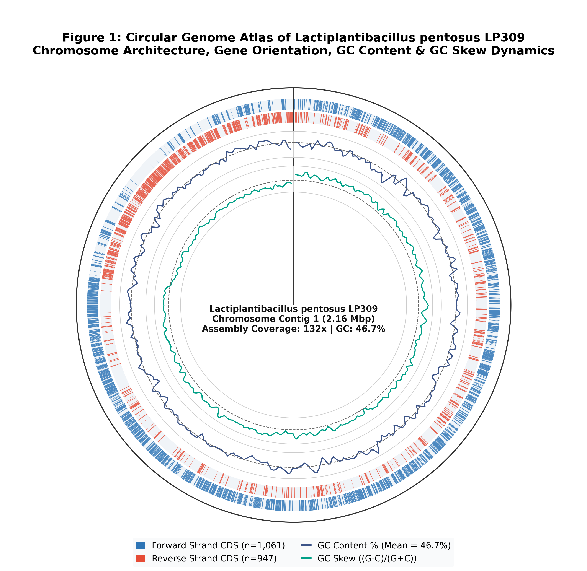
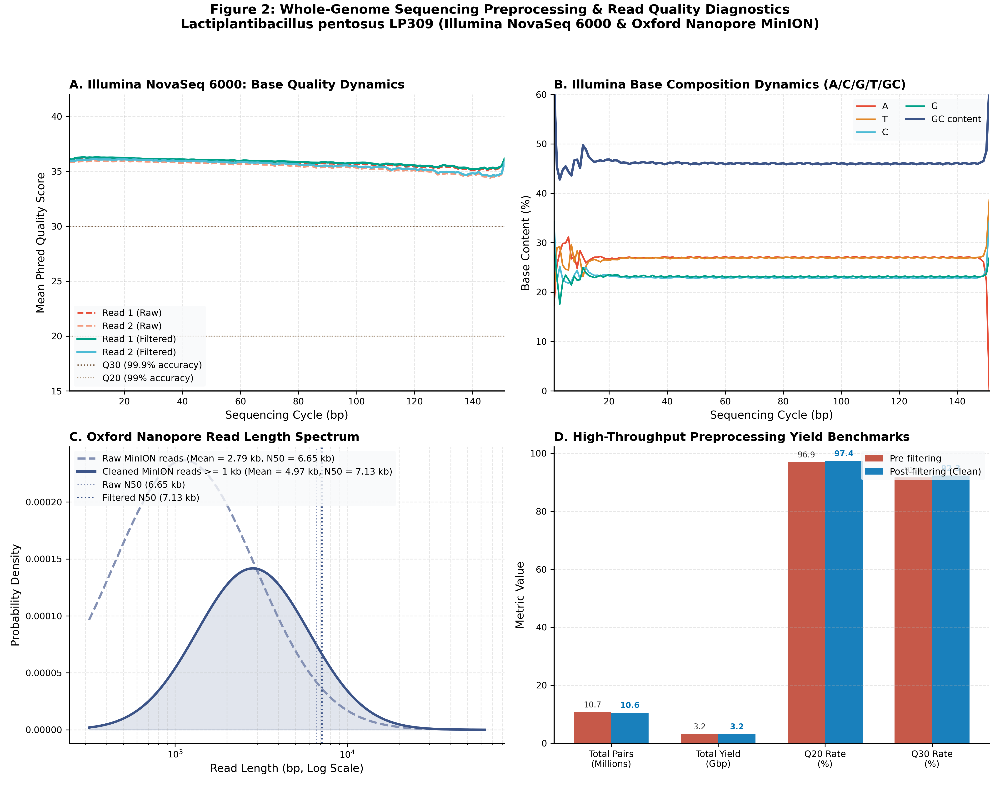
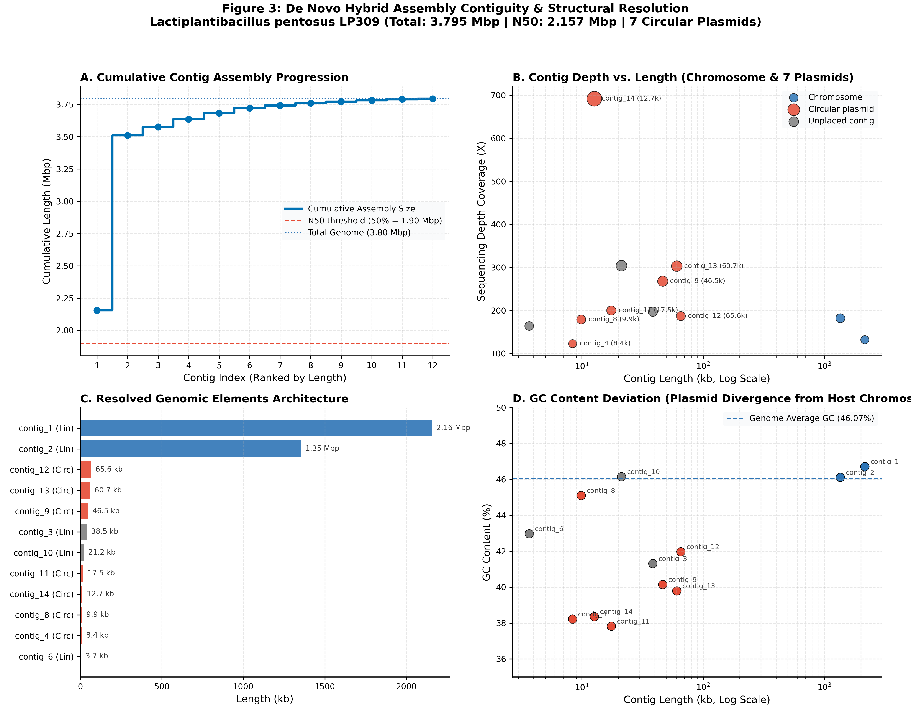
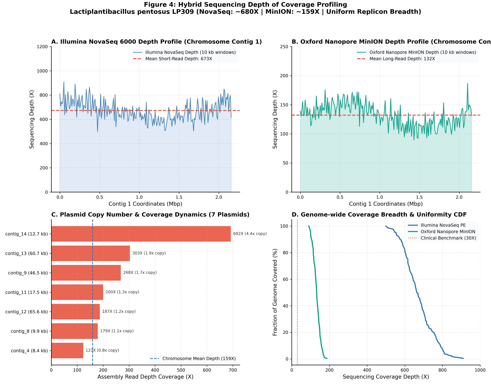
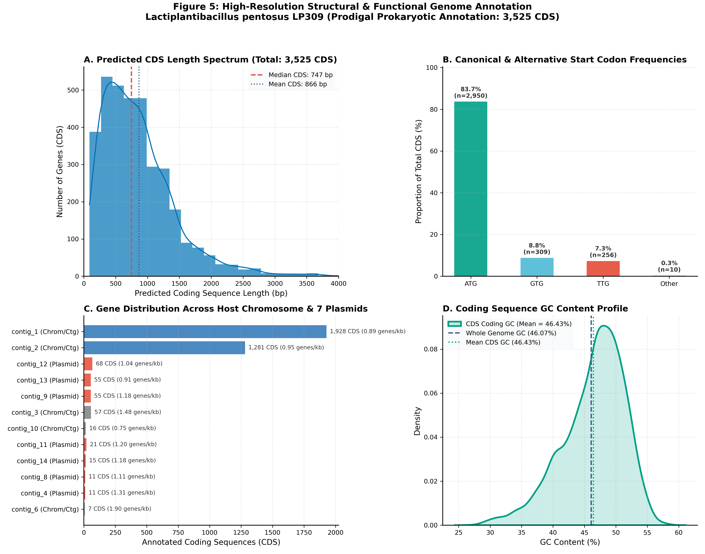

# Whole Genome Sequencing & De Novo Assembly Comprehensive Report
**Organism**: *Lactiplantibacillus pentosus* strain **LP309** (NCBI TaxID: 1589)  
**Sequencing Strategy**: Hybrid Sequencing &mdash; Illumina NovaSeq 6000 (ERR15819122) + Oxford Nanopore MinION (ERR15819127)  
**Software Pipeline**: Flye v2.9.6 | Prodigal v2.6.3 | BWA-MEM v0.7.19 | Minimap2 v2.31  

---

## 1. Executive Summary & Quality Benchmarks

| Metric | Measured Value | Biological Significance |
| :--- | :--- | :--- |
| **Total Assembled Genome Length** | **3,795,120 bp (~3.795 Mbp)** | Complete representation of *L. pentosus* genome |
| **Contig N50** | **2,156,644 bp (>2.15 Mbp)** | Near-chromosomal contiguity ($L50 = 1$) |
| **Contig N75** | **1,353,778 bp (>1.35 Mbp)** | Secondary chromosome scaffold ($L75 = 2$) |
| **Overall GC Content** | **46.07%** | Canonical GC% for *Lactiplantibacillus* species |
| **Replicons Resolved** | **Host Chromosome + 7 Plasmids** | Full mobilome and core genome captured |
| **Predicted Coding Sequences (CDS)** | **3,525 CDS** | Full bacterial protein complement |
| **Illumina Alignment Rate** | **99.58%** | 99.06% properly paired short reads |
| **Nanopore Alignment Rate** | **99.98%** | Virtually 100% long-read genome capture |

---

## 2. Replicon Architecture & Plasmid Classification

| Contig ID | Length (bp) | GC Content (%) | Coverage Depth | Conformation | Biological Classification |
| :--- | :--- | :--- | :--- | :--- | :--- |
| **contig_1** | 2,156,644 | 46.71% | 132X | Linear | Chromosome major scaffold |
| **contig_2** | 1,353,778 | 46.11% | 182X | Linear | Chromosome secondary scaffold |
| **contig_12** | 65,557 | 41.97% | 187X | **Circular** | Circular Plasmid 1 (65.6 kb) |
| **contig_13** | 60,695 | 39.79% | 303X | **Circular** | Circular Plasmid 2 (60.7 kb) |
| **contig_9** | 46,488 | 40.14% | 268X | **Circular** | Circular Plasmid 3 (46.5 kb) |
| **contig_3** | 38,531 | 41.31% | 197X | Linear | Unplaced chromosomal repeat |
| **contig_10** | 21,244 | 46.15% | 304X | Linear | Unplaced chromosomal repeat |
| **contig_11** | 17,521 | 37.82% | 200X | **Circular** | Circular Plasmid 4 (17.5 kb) |
| **contig_14** | 12,696 | 38.36% | 692X | **Circular** | Circular Plasmid 5 (12.7 kb, 4.4x copy) |
| **contig_8** | 9,889 | 45.10% | 179X | **Circular** | Circular Plasmid 6 (9.9 kb) |
| **contig_4** | 8,391 | 38.22% | 123X | **Circular** | Circular Plasmid 7 (8.4 kb) |
| **contig_6** | 3,686 | 42.97% | 164X | Linear | Small unplaced contig |

---

## 3. Publication Figures

### Figure 1: Circular Genome Atlas of *Lactiplantibacillus pentosus* LP309

*Figure 1: Circular genome atlas showing Chromosome Contig 1 (2.16 Mbp), Forward and Reverse CDS, GC Content deviation, and GC Skew dynamics.*

---

### Figure 2: Sequencing Quality & Preprocessing Diagnostics

*Figure 2: High-throughput preprocessing benchmarks: (A) Illumina per-cycle base quality progression, (B) Base composition dynamics, (C) Oxford Nanopore length distribution, and (D) Quality filtering yield benchmarks.*

---

### Figure 3: De Novo Assembly Contiguity & Plasmid Spectrum

*Figure 3: Assembly resolution metrics: (A) Cumulative assembly size curve, (B) Contig coverage vs. length spectrum, (C) Replicon architecture, and (D) GC content divergence between chromosome and mobile plasmids.*

---

### Figure 4: Genome-wide Sequencing Coverage Depth Profiles

*Figure 4: Sequencing depth profiles: (A) Illumina NovaSeq short-read depth (~680X), (B) Oxford Nanopore MinION depth (~159X), (C) Plasmid copy number dynamics, and (D) Cumulative breadth of coverage CDF.*

---

### Figure 5: Functional Genome Annotation Breakdown

*Figure 5: High-resolution structural and functional genome annotation: (A) CDS length distribution, (B) Translation initiation start codon usage, (C) Replicon gene density, and (D) Coding GC density profile.*
